# 📋 TaskFlow – Task Management Application

> **ApexLark Full Stack Development Internship · Day 07**
> JavaScript Mini Project built with **HTML5, CSS3, ES6+ JavaScript and the Local Storage API**.

TaskFlow is a lightweight, responsive task manager that lets employees create, update, delete, search, filter and track their daily work. Data is saved in the browser's Local Storage, so tasks are still there after a page refresh or browser restart.

---

## ✨ Features

### Task management (CRUD)
- **Create** tasks with Title, Description, Category, Priority (Low / Medium / High), Due Date, Status (Pending / In Progress / Completed) and an optional Assignee
- **Edit** any task: the form switches to *Edit mode*, is pre-filled, and can be cancelled
- **Delete** tasks through a custom **confirmation dialog** (closes with Cancel, Esc or a backdrop click)
- **Mark complete** with one click on the checkbox (click again to move it back to Pending)
- **Clear Completed**: remove all finished tasks at once (also asks for confirmation)

### Search, filter & sort
- **Live search** by task title while you type
- **Filter** by Category, Priority and Status (filters can be combined)
- **Sort** by Newest, Due Date (soonest / latest) or Priority (High → Low / Low → High)
- One-click **Reset** of search, filters and sort

### Dashboard analytics (updated in real time)
- Total, Completed, Pending, In Progress and High Priority task counts
- **Completion percentage** shown as a progress ring and a progress bar
- **Statistics section** with tasks by category, tasks by priority, and deadlines (Overdue / Due Today / Due This Week)

### Client-side validation
| Field | Rule |
|---|---|
| Title | Required, 3–60 characters |
| Description | Required, 10–300 characters (live character counter) |
| Category | Required, must be one of the listed options |
| Priority | Required (Low / Medium / High) |
| Due Date | Required, valid date, cannot be in the past (an existing past date may be kept while editing) |
| Status | Required (Pending / In Progress / Completed) |
| Assignee | Optional; if given: 2–40 characters, letters, spaces, `.` `'` `-` only |

Invalid fields are highlighted with an inline message and a shake animation, and the first invalid field gets focus.

### UI / UX
- 📱 **Fully responsive**: desktop, tablet and mobile (hamburger menu below 768px)
- 🌗 **Dark / Light theme toggle**: remembered in Local Storage, and follows the OS setting on the first visit
- 🔔 **Toast notifications** for every action (success, info, warning, error)
- 🗒️ **Empty states**: separate messages for "no tasks yet" and "no matching tasks"
- 🎞️ **Smooth CSS animations**: card fade-ins, task slide-out on delete, modal pop-in, toast slide-in, checkbox pop
- ⚠️ Overdue tasks and tasks due today are highlighted
- ♿ Accessibility: semantic HTML, ARIA labels, keyboard support, visible focus states, `prefers-reduced-motion` support
- 🔒 All user input is HTML-escaped before rendering (XSS-safe)
- 🔄 Tasks stay in sync across multiple open browser tabs

---

## 🛠️ Tech Stack

| Technology | Usage |
|---|---|
| HTML5 | Semantic layout (header, nav, main, section, article, footer), form |
| CSS3 | CSS variables for theming, Flexbox, Grid, media queries, keyframe animations |
| JavaScript (ES6+) | ES Modules, arrow functions, destructuring, spread, template literals, Promises/async-await, optional chaining |
| Local Storage API | Saves tasks and the theme preference |

**ES6 concepts used:** `import` / `export` modules · arrow functions · object & array destructuring · spread/rest operators · template literals · `map`, `filter`, `find`, `sort`, `forEach`, `includes` · `async/await` with a Promise-based confirm dialog · default parameters · optional chaining `?.` and nullish coalescing `??`.

---

## 📁 Folder Structure

```
Day-07-Task-Management/
│
├── index.html                  # App layout: header, nav, dashboard, form, task list, statistics, footer
├── css/
│   ├── style.css               # Theme variables, components, animations
│   └── responsive.css          # Breakpoints: 1200px, 992px, 768px, 480px
├── js/
│   ├── app.js                  # Entry point: state, CRUD, search/filter/sort, stats, events
│   ├── storage.js              # Local Storage read/write (tasks + theme)
│   ├── ui.js                   # DOM rendering, toasts, modal, form helpers, theme
│   └── validation.js           # Form validation rules and constants
├── assets/
│   ├── images/
│   │   ├── empty-state.svg
│   │   └── screenshots/        # Application screenshots
│   └── icons/
│       └── logo.svg
└── README.md
```

### Module responsibilities

```
            ┌──────────────┐
            │    app.js    │  state + event handling + business logic
            └──────┬───────┘
     import        │        import          import
   ┌───────────────┼───────────────────────────┐
   ▼               ▼                           ▼
storage.js     validation.js                 ui.js
(Local Storage) (rules, constants)  (rendering, toasts, modal, theme)
```

---

## 🚀 How to Run

> ⚠️ The app uses **ES6 modules** (`<script type="module">`). Browsers block modules that are opened directly from the file system (`file://`), so the project **must be served by a local web server**.

**Option 1: VS Code Live Server (recommended)**
1. Open the `Day-07-Task-Management` folder in VS Code
2. Install the **Live Server** extension
3. Right-click `index.html` → **Open with Live Server**

**Option 2: Python**
```bash
cd Day-07-Task-Management
python -m http.server 5500
# open http://localhost:5500
```

**Option 3: Node.js**
```bash
npx serve .
```

**Option 4: GitHub Pages**: push the repo, then go to *Settings → Pages → Deploy from branch → main / root*.

---

## 💾 Local Storage Data Format

Key: `taskflow.tasks`

```json
[
  {
    "id": "3f1c8e5a-6b0d-4c1e-9a7f-2d4b8c6e1a90",
    "title": "Prepare sprint report",
    "description": "Compile velocity charts and blockers for the weekly sprint review.",
    "category": "Work",
    "priority": "High",
    "dueDate": "2026-11-13",
    "status": "In Progress",
    "assignee": "Priya Sharma",
    "createdAt": 1762934400000,
    "updatedAt": 1762934400000
  }
]
```

Key: `taskflow.theme` → `"light"` or `"dark"`

Every create, update, delete, toggle and clear operation is saved to Local Storage straight away, and the UI is re-rendered from the saved state.

---

## 📸 Screenshots

### Dashboard – Light Theme
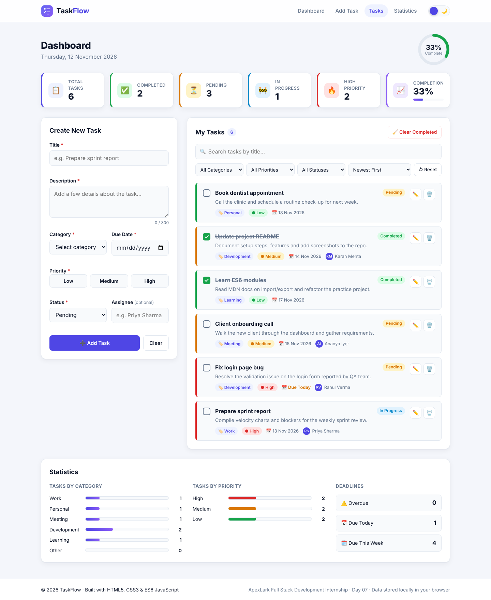

### Dashboard – Dark Theme
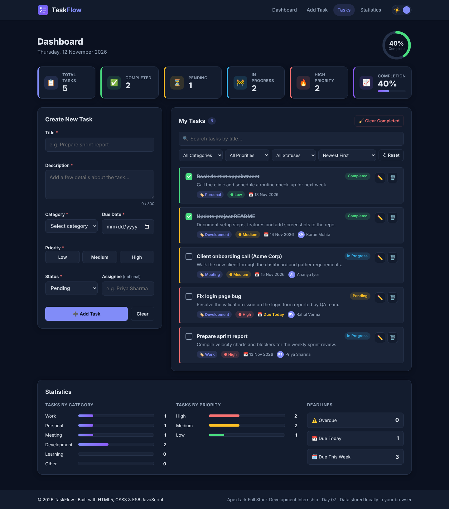

### Empty State
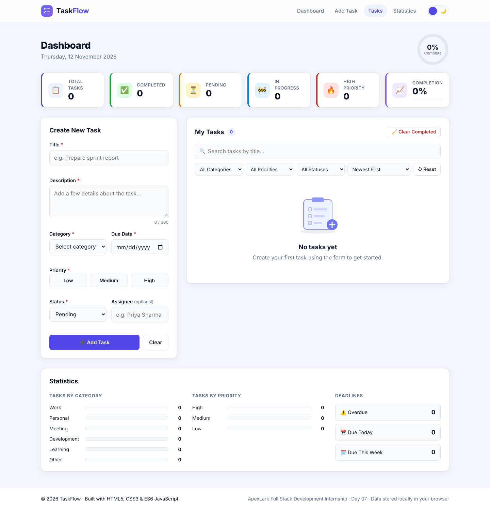

### Form Validation
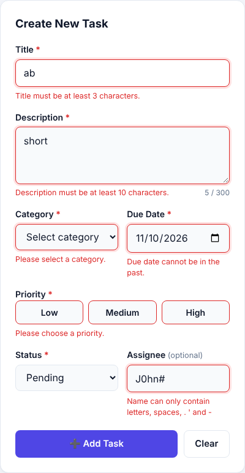

### Search & Filter
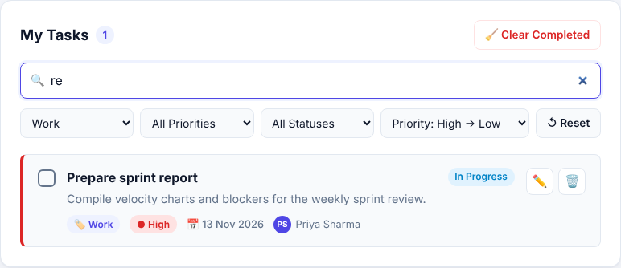

### Edit Task
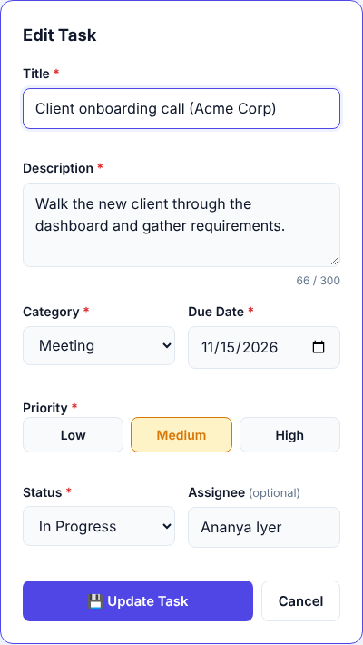

### Toast Notification
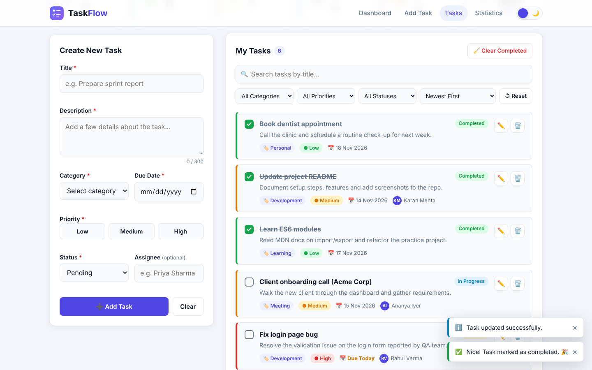

### Delete Confirmation Dialog
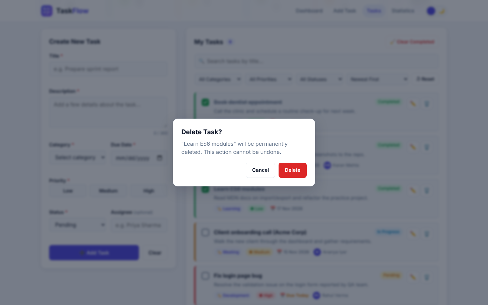

### Statistics
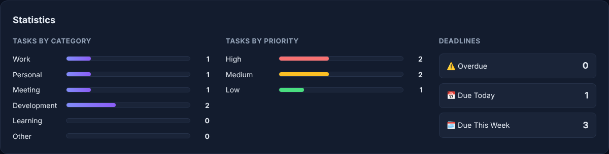

### Mobile View
| Dashboard | Menu | Task List |
|---|---|---|
| 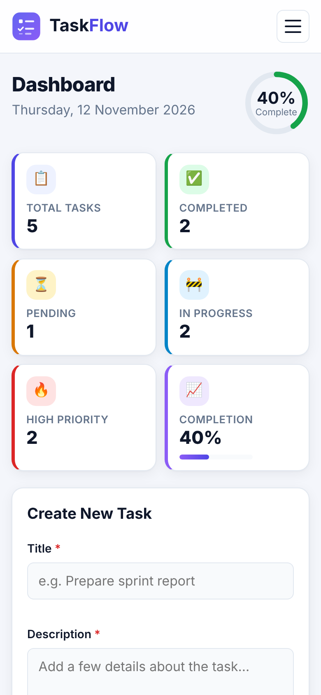 | 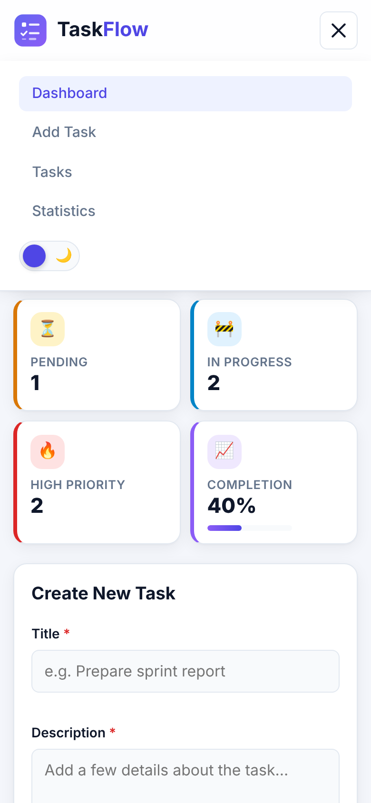 | 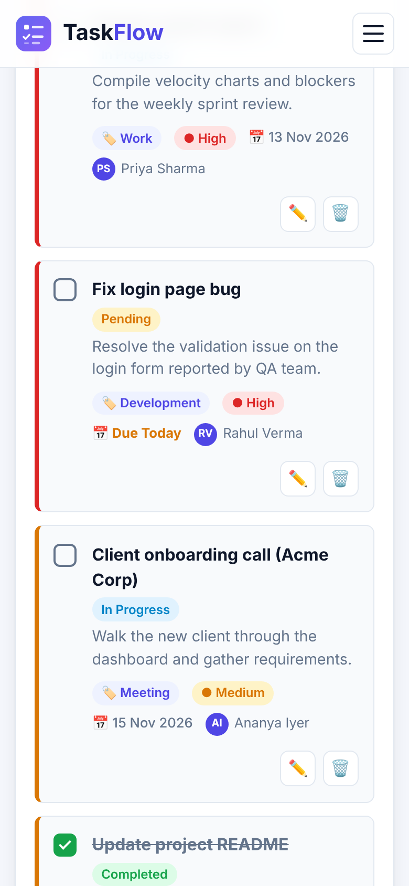 |

---

## ✅ Testing Checklist

- [x] Submitting an empty form shows validation errors on all required fields
- [x] Invalid title, description, past date and invalid assignee name are rejected
- [x] Creating a task adds it to the list and updates all dashboard numbers
- [x] Tasks are still there after a page reload
- [x] Editing a task pre-fills the form and saves the changes
- [x] Delete asks for confirmation; Cancel keeps the task, Delete removes it
- [x] Checkbox toggles Completed / Pending and updates the completion %
- [x] Live search, each filter, combined filters and all sort options work
- [x] "No matching tasks" empty state appears when a search has no results
- [x] Theme toggle works and is remembered after a reload
- [x] No horizontal scrolling at 390px (mobile) or 820px (tablet)
- [x] No console errors

---

## 🎯 Learning Outcomes

- Built a complete, real-world front-end application in vanilla JavaScript
- Did client-side CRUD with persistent state in Local Storage
- Organized the code into ES6 modules with a clear separation of concerns (state, storage, validation, UI)
- Built a responsive, accessible, event-driven interface with dark/light theming

---

## 👤 Author

**Your Name**
Full Stack Development Intern – ApexLark
GitHub: [@your-username](https://github.com/your-username)

---

<p align="center">Made with ❤️ during the ApexLark Full Stack Development Internship</p>
